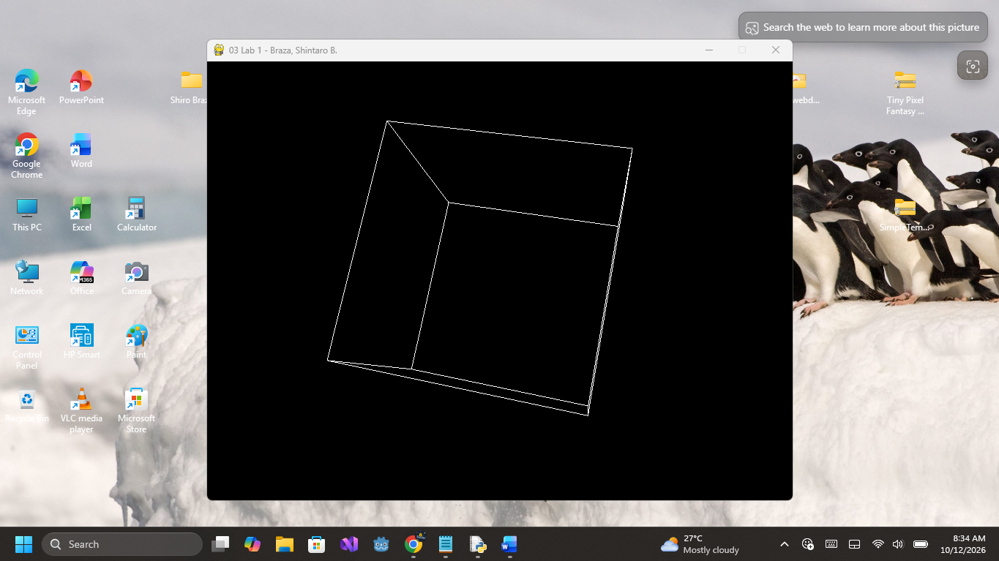

# Python OpenGL Rotating Cube

## About the Project
A simple 3D wireframe cube rendered using Python, Pygame, and PyOpenGL.

## Features
- 3D cube built from vertices and edges
- OpenGL perspective projection
- Continuous cube rotation
- Interactive graphics window

## Technologies Used
- Python
- Pygame
- PyOpenGL
- OpenGL Utility Library (GLU)

## Installation
Install the required Python packages:

```bash
python -m pip install pygame PyOpenGL PyOpenGL_accelerate
```

## How to Run
1. Install Python and the required packages.
2. Download or clone this repository.
3. Run the program:

```bash
python main.py
```

## Learning Objectives
- Understanding 3D vertices and edges
- Drawing wireframe objects
- Using OpenGL transformations
- Creating a graphics loop with Pygame

  
## Screenshot



